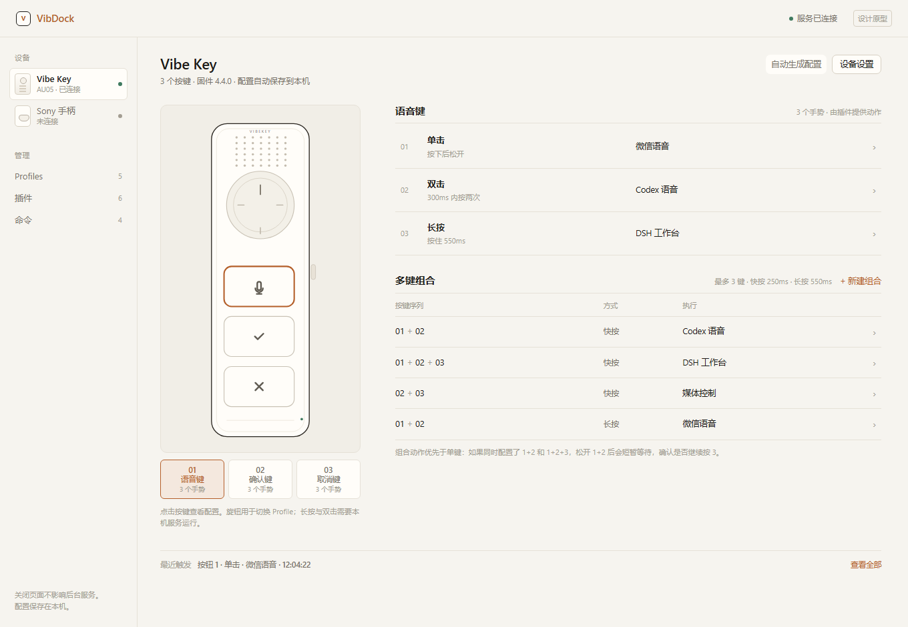
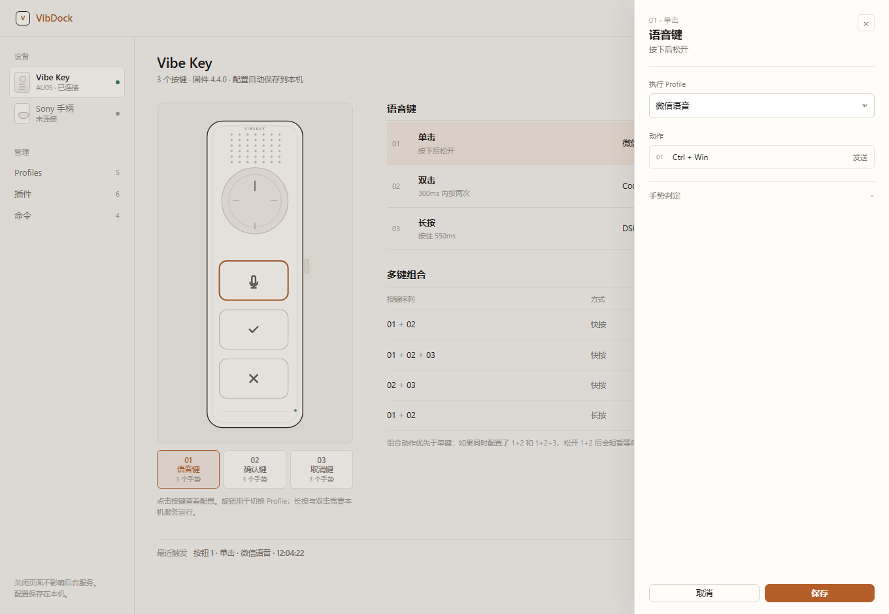
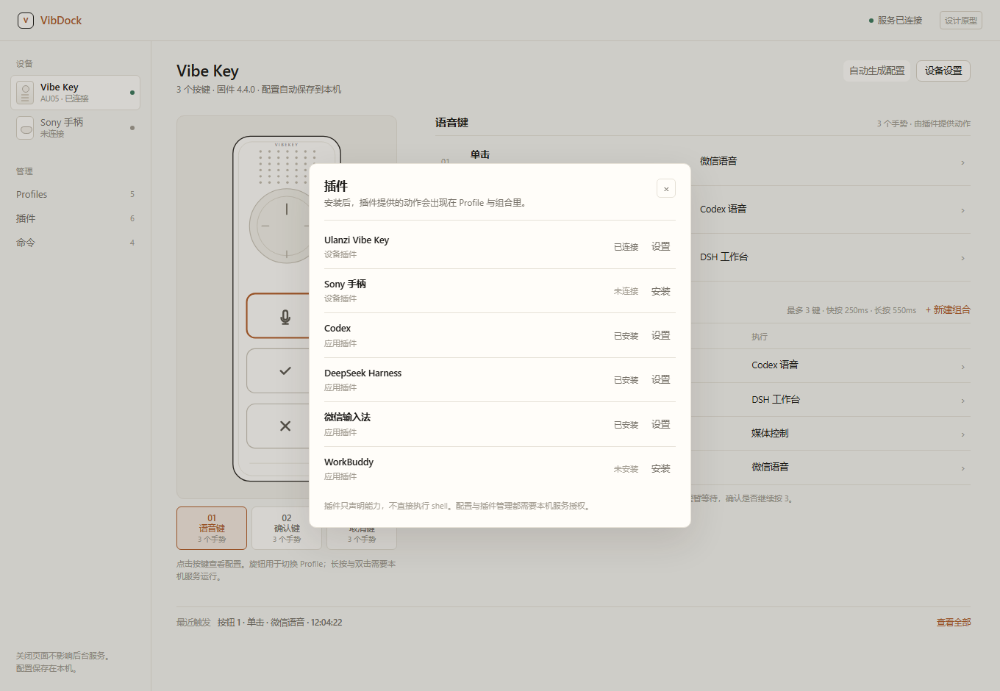
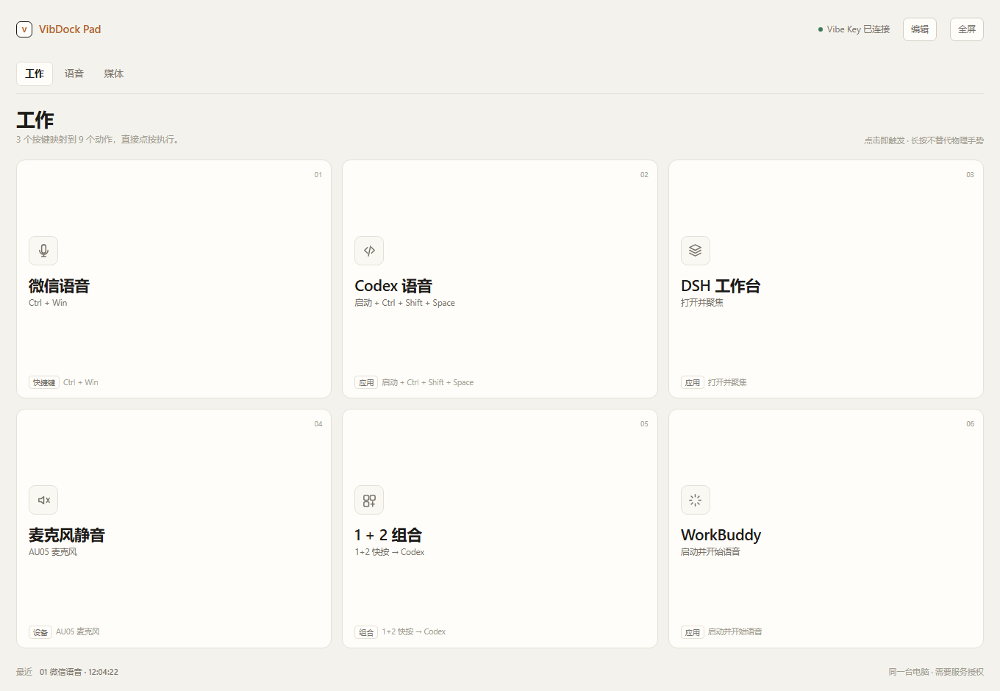
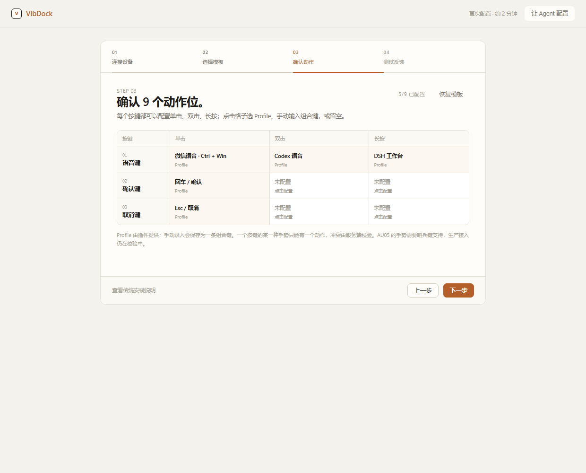
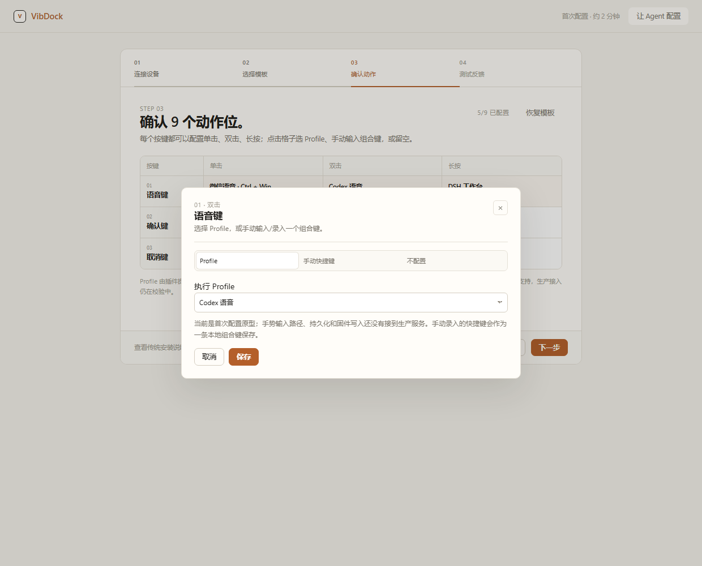

<p align="center">
  <picture>
    <source media="(prefers-color-scheme: dark)" srcset="assets/brand/vibdock-symbol-light.svg">
    
  </picture>
</p>

<h1 align="center">VibDock</h1>

<p align="center"><b>One key. Your whole AI workflow.</b><br>
A local-first bridge between hardware controls, voice workflows and personal AI agents.</p>

<p align="center">
  <a href="README.zh-CN.md">简体中文</a> ·
  <a href="README.technical.md">Technical README</a> ·
  <a href="#quick-start">Quick start</a> ·
  <a href="#interface">Interface</a> ·
  <a href="#guided-setup">Guided setup</a>
</p>

<p align="center">
  
  
  
  
</p>

<p align="center">
  
</p>

VibDock turns a small physical keypad into a controller for coding agents, voice
input and everyday desktop actions. Press a key to talk to Codex or DeepSeek
Harness, mute the microphone, launch a workflow, or run a saved sequence —
without installing the vendor's Studio and without sending data to a cloud
service.

The UI is served by the same resident Rust service that owns the device, global
hotkeys and process actions. The browser is the config surface, not a remote
control with extra privileges.

## What it does

- **Physical keys, no vendor Studio.** First-run defaults write `Ctrl + Win`
  (WeChat voice), `Enter` and `Escape` into the three Ulanzi AU05 buttons over
  the vendor HID interface, with readback verification.
- **One key, a sequence of actions.** Launch an app, send a chord, toggle a
  microphone, run a local structured command, or wait. Steps run in order and
  stop at the first failure.
- **Gestures and combos, designed in.** Three buttons become more than three
  actions: single / double / long press, plus `1+2`, `1+2+3`, `2+3` and held
  two-button combos.
- **A touch-first Pad.** Project the same profiles as large virtual keys on a
  tablet or second screen. The browser asks the local service to execute a saved
  action; it never injects input itself.
- **A plugin-shaped core.** Device, input and action layers are Rust crates with
  manifests and capability checks, so another keypad or agent integration does
  not require editing the host for every button.

## Interface

<table>
<tr>
<td width="50%"><br><sub><b>Workbench.</b> Pick a key, see its three gestures and multi-key combos.</sub></td>
<td width="50%"><br><sub><b>Editor.</b> A drawer keeps the page quiet: choose a profile, inspect steps, adjust timing.</sub></td>
</tr>
<tr>
<td width="50%"><br><sub><b>Plugins.</b> Device and application capabilities in one place, with an explicit install state.</sub></td>
<td width="50%"><br><sub><b>Virtual Pad.</b> Large touch targets for a tablet or a second screen.</sub></td>
</tr>
</table>

> These images are the current **product design preview**. The production
> Settings page is being migrated to this workbench; the source still builds the
> earlier Settings UI. The Pad has a working `POST /api/pad/execute` path and a
> static prototype, but the `/pad` route and pairing flow are not served yet.

## Quick start

**For users:** download a published archive from
[Releases](https://github.com/loonghao/vibdock/releases), extract both
executables into one folder, and run `vibdock-launcher.exe`. The launcher keeps
the tray service running and opens authenticated local Settings.

**From source (Windows 10/11):**

```powershell
git clone https://github.com/loonghao/vibdock.git
cd vibdock
cargo build --release
.\target\release\vibdock-launcher.exe
```

No Node.js, Python or separate web server is required. The published v0.1.0
preview is older than the current source; the AU05/action work is a source
candidate, not a new release.

## Guided setup

A first-run flow is designed around four steps: connect the device, choose a
template, confirm the 3×3 gesture matrix, then test.



Every key exposes single, double and long press. Click a cell to choose a Profile,
type a chord manually, or record one; the grid is the same 3×3 gesture matrix used
by the workbench.



- [Install and configure guide](docs/guide/installation.md) — traditional setup,
  direct chords, application shortcuts, hardware actions, verification,
  troubleshooting and uninstall.
- [Interactive onboarding prototype](docs/design/onboarding.html) — clickable
  steps and an Agent prompt; the production Settings migration is still in
  progress.

## Let an agent configure it

VibDock ships an [Agent skill](skills/vibdock/SKILL.md) plus a
[helper](scripts/vibdock-agent.ps1). A user can say:

> Bind button 2 to open Codex, and put WeChat voice on button 1. Read the current
> configuration first; do not overwrite anything without asking.

The agent reads `GET /api/plugins`, `GET /api/actions` and `hardware-status`,
resolves application references instead of guessing paths, asks before writing
firmware, and reports the readback and recent-trigger result.

## How it fits together

```
vibdock-launcher / vibdock-cli
            │
            ▼
      VibDock host           auth, config, profiles, actions, API
      ├── vibdock-device-au05      AU05 HID + firmware readback
      ├── vibdock-device-gamepad   generic HID gamepad
      ├── vibdock-actions          action/profile schema + commands
      ├── vibdock-input            hotkey, gesture and combo matching
      ├── vibdock-au05             pure AU05 protocol
      └── vibdock-plugin-api       manifest, capability and plugin traits
```

The device and action crates are already independent of the service and web
layer. The host advertises built-in plugin manifests at `GET /api/plugins` and
the next extraction steps are tracked in the open roadmap.

## Honest status

| Area | Current state |
| --- | --- |
| AU05 direct firmware bindings | Verified on a real device: defaults, readback, direct chord, physical action |
| Hardware action sequences | Wait-step execution verified; launch/send-keys/mic/command chain implemented, full chain not live-tested |
| Gestures and combos | Classifiers unit-tested; Windows sentinel-key monitoring and persisted bindings are in progress |
| Gamepad | Adapter implemented; no live gamepad was available for acceptance |
| Virtual Pad | Prototype + saved-action execution endpoint; `/pad` route and pairing pending |
| Plugin framework | Device/action/input crates extracted; read-only built-in registry; third-party sidecar pending |

See the full acceptance notes in [docs/testing](docs/testing) and the technical
detail in [README.technical.md](README.technical.md). Do not treat a sent chord
or a successful API response as proof that an application changed state.

## Design and agent docs

- [Design workbench, clean direction](docs/design/prototype-clean.html)
- [Virtual Pad design](docs/design/virtual-pad.md)
- [Plugin modularization](docs/design/plugin-modularization.md)
- [Agent skill](skills/vibdock/SKILL.md) — safe CLI/API workflows for agents
- [Agent helper](scripts/vibdock-agent.ps1) — reads the local token without printing it
- [Roadmap issues](https://github.com/loonghao/vibdock/issues/71)

## Development

```powershell
cargo fmt --all --check
cargo clippy --workspace --locked --all-targets -- -D warnings
cargo test --workspace --locked --all-targets
node scripts/test-binding-ui.cjs
```

The detailed technical README keeps the complete feature matrix, API contract,
permissions, device quirks and acceptance checklist: **[README.technical.md](README.technical.md)**.

## License

MIT. VibDock is independent of Ulanzi, OpenAI, DeepSeek, Tencent and WorkBuddy;
product names are used only to describe integrations.

<p align="center"><a href="README.zh-CN.md">阅读中文版 →</a></p>


